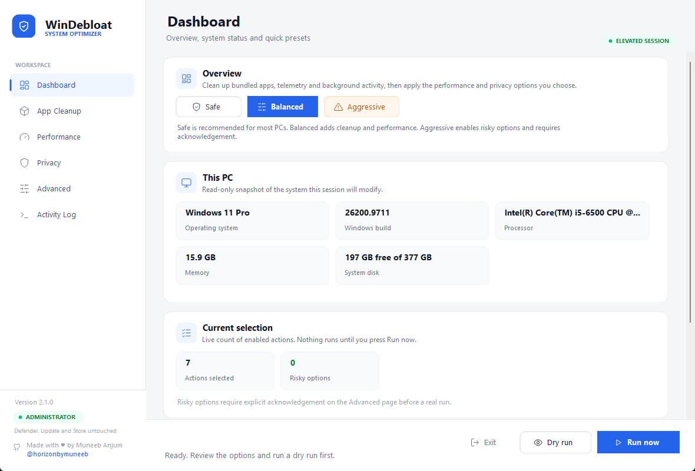
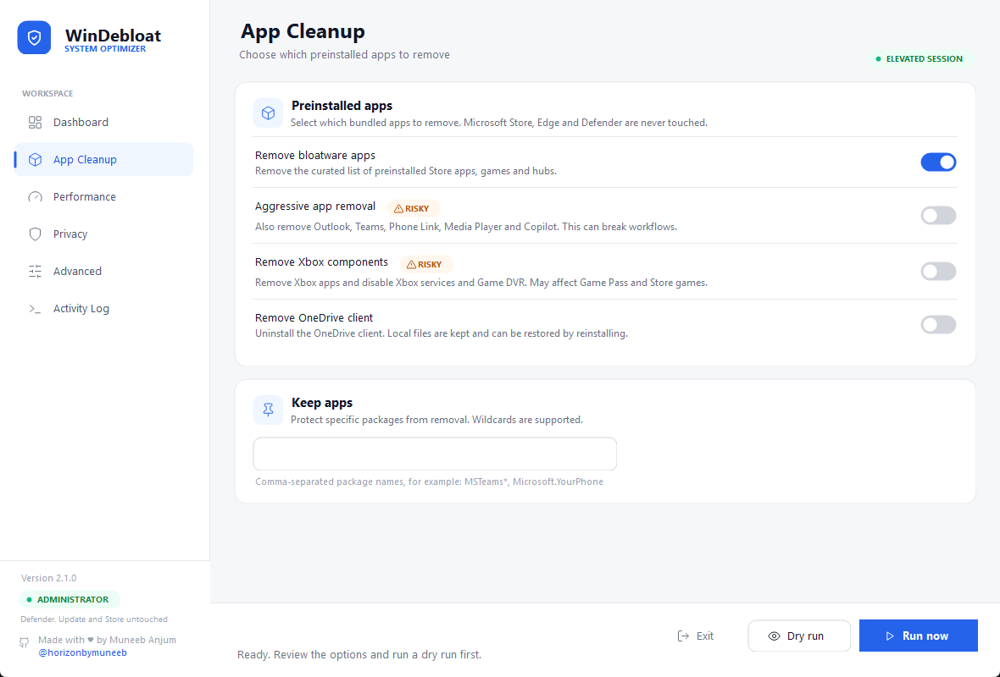
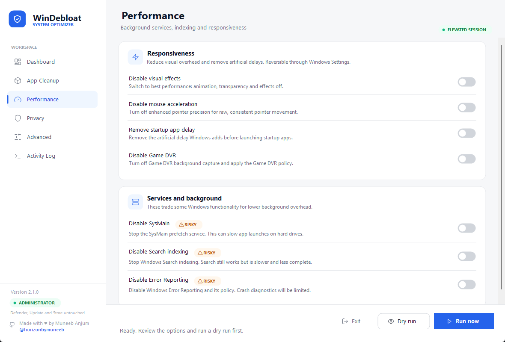
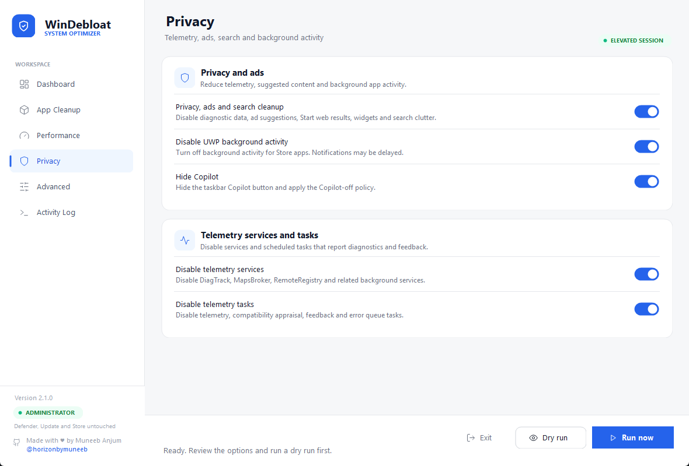
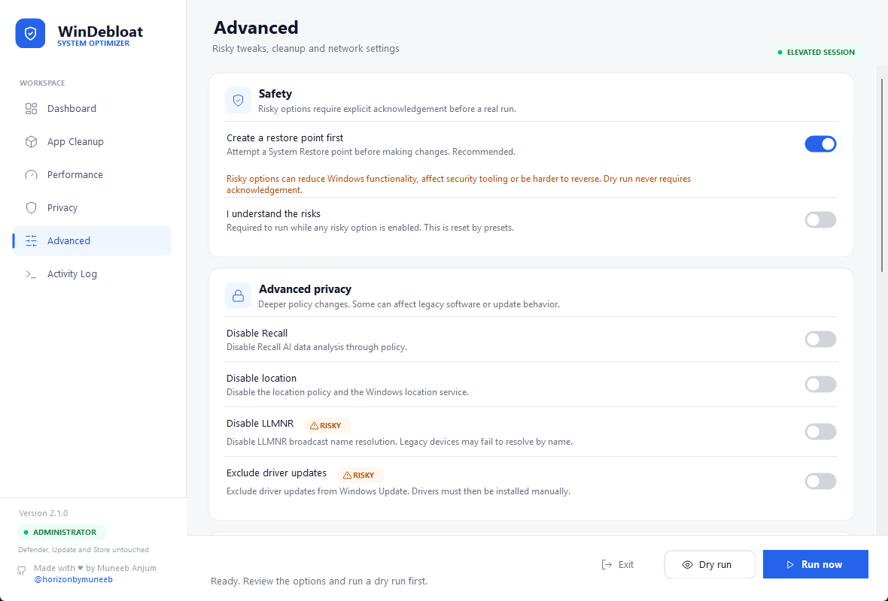
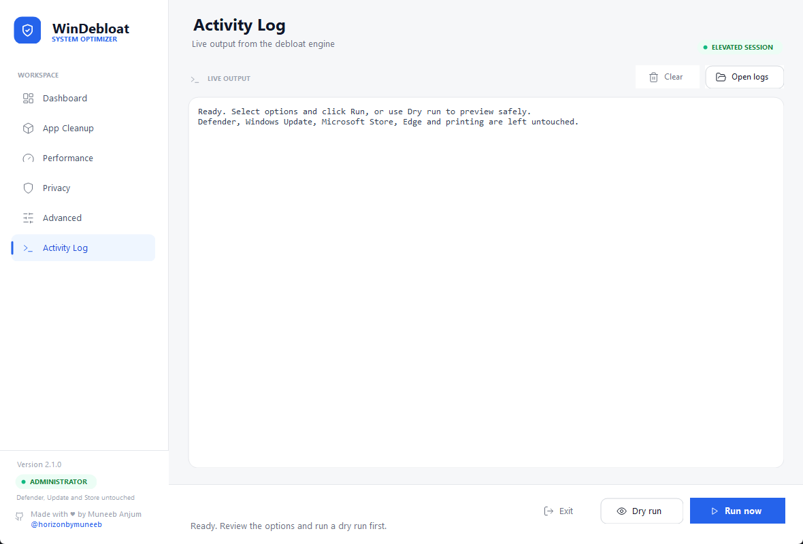

# WinDebloat

<p align="center">
  
</p>

<p align="center">
  A clean, local-first debloater and optimizer for Windows 10 and 11 — with a proper GUI and a scriptable CLI.
</p>

<p align="center">
  
  
  
  
  
  <a href="https://github.com/horizonbymuneeb/WinDebloat/releases/latest"></a>
  <a href="https://github.com/horizonbymuneeb"></a>
</p>



WinDebloat removes curated preinstalled apps, trims telemetry and background noise, and applies reversible performance tweaks. Everything runs locally from a single folder — no installers, no cloud calls, no third-party dependencies.

## Features

- **App cleanup** — remove a curated list of preinstalled Store apps, games and hubs. Microsoft Store, Edge and Defender are never touched.
- **Keep apps** — protect specific packages with a comma-separated list, wildcards supported (`MSTeams*`).
- **Performance** — disable visual effects, mouse acceleration, startup app delay, Game DVR, SysMain, search indexing and error reporting.
- **Privacy** — disable telemetry services and scheduled tasks, ads and suggestions, UWP background activity, Copilot, Recall, location and LLMNR.
- **Cleanup** — temp files, Windows Update cache, Delivery Optimization files, thumbnail cache and the recycle bin.
- **Network** — set DNS to Cloudflare, Google or Quad9, or restore automatic DNS.
- **Power** — disable hibernation or enable the Ultimate Performance plan.
- **Presets** — Safe, Balanced and Aggressive configurations in the GUI.
- **Dry run** — preview every action without changing anything.
- **Live log** — watch the engine output in real time; every run is transcribed to `logs/`.

## Safety

- Microsoft Defender, Windows Update, Microsoft Store, Microsoft Edge and printing are never removed. Optional cache cleanup does not uninstall Windows Update.
- A System Restore point is attempted before any change (can be disabled; Windows may skip it if one was created in the last 24 hours).
- Risky options are badged and require explicit acknowledgement in the GUI before a real run.
- Dry runs never modify the system.
- Every run is logged to `logs/` next to the scripts.

> [!WARNING]
> This tool changes system settings and removes preinstalled apps. Review the selected options, run a dry run first, and keep a backup or restore point. Use at your own risk.

## Quick start

**Requirements:** Windows 10 or 11, Windows PowerShell 5.1, administrator rights.

1. Download the [latest release](https://github.com/horizonbymuneeb/WinDebloat/releases/latest) ZIP and extract it, or clone this repository.
2. Double-click `Debloat-GUI.bat` and approve the UAC prompt.
3. Pick a preset, run a **Dry run**, then click **Run now**.

```powershell
git clone https://github.com/horizonbymuneeb/WinDebloat.git
cd WinDebloat
.\Debloat-GUI.bat
```

For a one-click CLI run with safe defaults, use `OneClick-Debloat.bat` instead.

## GUI

| Page | What it controls |
| --- | --- |
| Dashboard | Presets, session summary and run controls |
| App Cleanup | Curated app removal, aggressive/Xbox/OneDrive options, keep list |
| Performance | Visual effects, input, startup delay, Game DVR, services |
| Privacy | Telemetry, ads, background apps, Copilot, Recall, location |
| Advanced | Risky tweaks, cleanup, DNS, power and restore point |
| Activity Log | Live engine output, open logs or clear the view |

## Screenshots

| Dashboard | App Cleanup |
| --- | --- |
|  |  |
| **Performance** | **Privacy** |
|  |  |
| **Advanced** | **Activity Log** |
|  |  |

## CLI usage

Run from an elevated PowerShell prompt:

```powershell
# Preview the default run without changing anything
.\WinDebloat.ps1 -DryRun

# Safe defaults: restore point, curated apps, telemetry and ads
.\WinDebloat.ps1

# Performance and cleanup
.\WinDebloat.ps1 -DisableVisualEffects -DisableMouseAcceleration -DisableStartupDelay `
  -CleanTemp -CleanUpdateCache -EmptyRecycleBin -DnsProvider Cloudflare

# More aggressive, with risky options
.\WinDebloat.ps1 -Aggressive -DisableSysMain -DisableSearchIndexing -DisableWerService `
  -DisableRecall -DisableLocation -DisableLlmnr -DisableDriverUpdates

# Keep specific packages
.\WinDebloat.ps1 -KeepApps "MSTeams*","Microsoft.YourPhone"
```

Useful switches:

| Switch | Effect |
| --- | --- |
| `-DryRun` | Preview only, no changes |
| `-Force` | Skip the 5-second countdown |
| `-NoRestorePoint` | Skip restore point creation |
| `-Aggressive` | Include Outlook, Teams, Phone Link, Media Player and Copilot |
| `-RemoveXbox` / `-RemoveOneDrive` | Remove Xbox components / the OneDrive client |
| `-SkipApps` / `-SkipServices` / `-SkipTasks` / `-SkipPrivacy` | Skip a whole category |
| `-KeepApps <names>` | Comma-separated packages to protect |
| `-DnsProvider <name>` | `Cloudflare`, `Google`, `Quad9`, `Automatic` or `None` |
| `-CleanTemp`, `-CleanUpdateCache`, `-CleanDeliveryOptimization`, `-CleanThumbnailCache`, `-EmptyRecycleBin` | Cleanup actions |
| `-DisableHibernation`, `-UltimatePerformance` | Power tweaks |

Run `Get-Help .\WinDebloat.ps1 -Full` for the complete parameter list.

## Project structure

```
WinDebloat/
├─ WinDebloat-GUI.ps1    # WinForms GUI with a custom light theme
├─ WinDebloat.ps1        # CLI debloat engine
├─ ui/
│  └─ WinDebloatUi.cs    # Custom controls and SVG icon renderer
├─ assets/
│  ├─ icons/             # SVG icon set used by the GUI
│  ├─ logo.svg
│  └─ screenshot.png
├─ Debloat-GUI.bat       # GUI launcher
├─ OneClick-Debloat.bat  # CLI launcher
└─ logs/                 # Created at runtime
```

## How it works

- The GUI is Windows PowerShell 5.1 + WinForms. Custom controls in `ui/WinDebloatUi.cs` provide the rounded cards, toggles and SVG icons; no external UI libraries are used.
- The CLI engine is a single PowerShell script. It uses built-in cmdlets only and writes a transcript to `logs/`.
- Nothing is downloaded or sent anywhere at runtime.

## Contributing

Issues and pull requests are welcome. Please keep changes PowerShell 5.1 compatible and test with `-DryRun` before opening a PR.

## License

[MIT](LICENSE) © WinDebloat contributors

---

<p align="center">
  <sub>Made with ♥ by <a href="https://github.com/horizonbymuneeb">Muneeb Anjum</a> · <a href="https://github.com/horizonbymuneeb">@horizonbymuneeb</a></sub>
</p>
